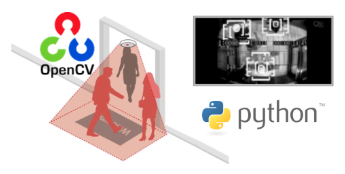
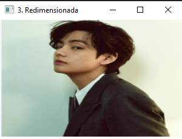
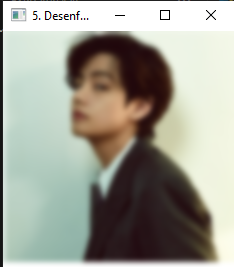
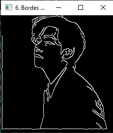
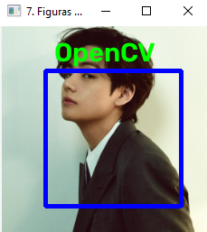
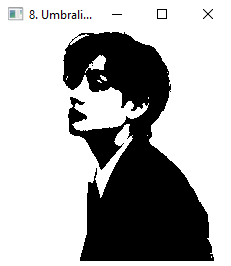
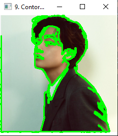

## Ramirez Azul NC 0441
## Procesamiento de Imágenes con OpenCV

## Imagen original 

## 2. Lectura y visualización de la imagen

## 3. Conversión de espacio de color a escala de grises

## 4. Redimensionamiento de la imagen 

## 5. Rotación de la imagen a 90 grados 

## 6. Aplicación de desenfoque gaussiano 

## 7. Detección de bordes mediante el algoritmo Canny

## 8. Dibujo de figuras geométricas y texto 

## 9. Umbralización 

## 10. Detección y trazado de contornos 
